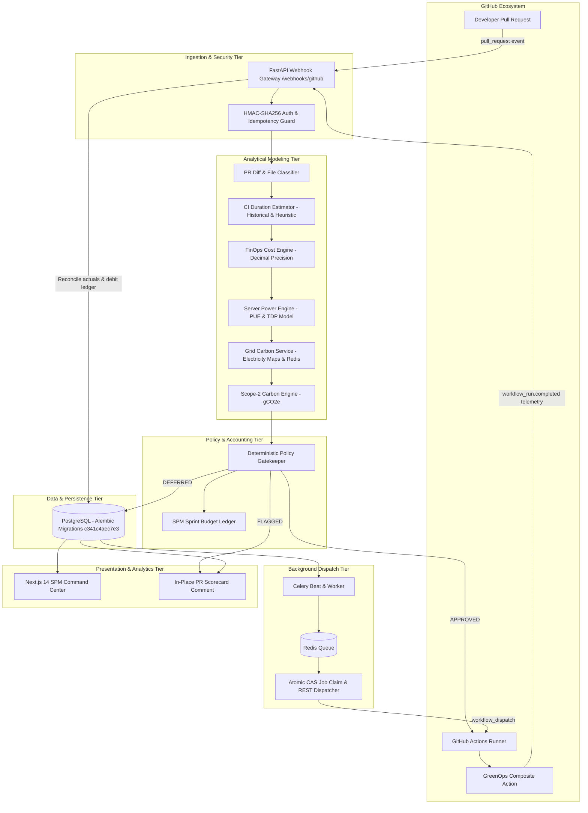

# GreenOps System Architecture & Design Specification

GreenOps is an asynchronous, event-driven middleware connecting GitHub pull requests, cloud compute runners, regional power grid carbon intensity datasets, and Software Project Management (SPM) sprint accounting ledgers.

---

## 1. High-Level Architecture Diagram

---

## 2. Core Architectural Pillars & Invariants

### 1. Shift-Left FinOps & Carbon Governance
Traditional FinOps is retrospective—organizations discover cloud waste weeks after billing cycles close. GreenOps moves governance left into the pre-merge pull-request lifecycle. By evaluating resource consumption against active sprint budgets before code merges, runaway pipeline expenditure is prevented.

### 2. Explainable Deterministic Modeling
GreenOps intentionally avoids black-box machine learning for baseline estimations:
- **Duration**: Combines historical median durations for identical repository workflows with deterministic heuristic multipliers based on file categorization (source, unit tests, integration tests, CI configuration).
- **Compute Cost**: High-precision Python `Decimal` arithmetic using exact runner pricing per minute.
- **Server Power**: Cloud server TDP modeling with baseline idle wattage ($10\text{W}$), peak wattage ($50\text{W}$), estimated CPU utilization ($70\%$), and data center PUE ($1.15$).
- **Carbon Emissions**: Scope-2 emissions calculated using live or cached regional grid carbon intensity ($\text{gCO}_2\text{e}/\text{kWh}$).

### 3. Dual-Tier Idempotency Architecture
Network failures and webhook retries are standard in distributed CI/CD environments. GreenOps enforces two layers of defense against duplicate side effects:
1. **Webhook Ingestion Layer**: Every inbound delivery ID (`X-GitHub-Delivery`) is stored in `webhook_events`. Repeated delivery IDs immediately return `idempotent_skip`.
2. **Financial Ledger Layer**: In `record_pipeline_ledger_entry()`, debits are keyed by `(sprint_id, pipeline_run_id, entry_type)`. If alternate delivery IDs or concurrent telemetry events arrive for the same execution, GreenOps updates the existing ledger record instead of double-billing the sprint budget.

### 4. Distributed Concurrency & At-Least-Once Dispatch
When deferred jobs are queued for lower-carbon execution windows:
- **Atomic Compare-and-Swap (CAS)**: Workers execute a single SQL conditional update (`status = "SCHEDULED"` where status is `PENDING` or stale `SCHEDULED`). Only the winning worker proceeds.
- **Stale Claim Recovery**: If a worker crashes before completing dispatch, the claim expires after 5 minutes (`CLAIM_TIMEOUT_MINUTES`), allowing subsequent scheduler ticks to safely reclaim the job.
- **At-Least-Once Semantics**: Because GitHub's `workflow_dispatch` endpoint does not support client idempotency tokens, GreenOps guarantees at-least-once external triggering, while protecting downstream accounting via the webhook idempotency layer.

### 5. Migration-Governed Database Evolution
Database tables are strictly version-controlled with Alembic (`head: c341c4aec7e3`). The backend lifespan configuration strictly bypasses `Base.metadata.create_all()` in production environments, ensuring that schema modifications are always executed through deterministic, reversible migrations.
