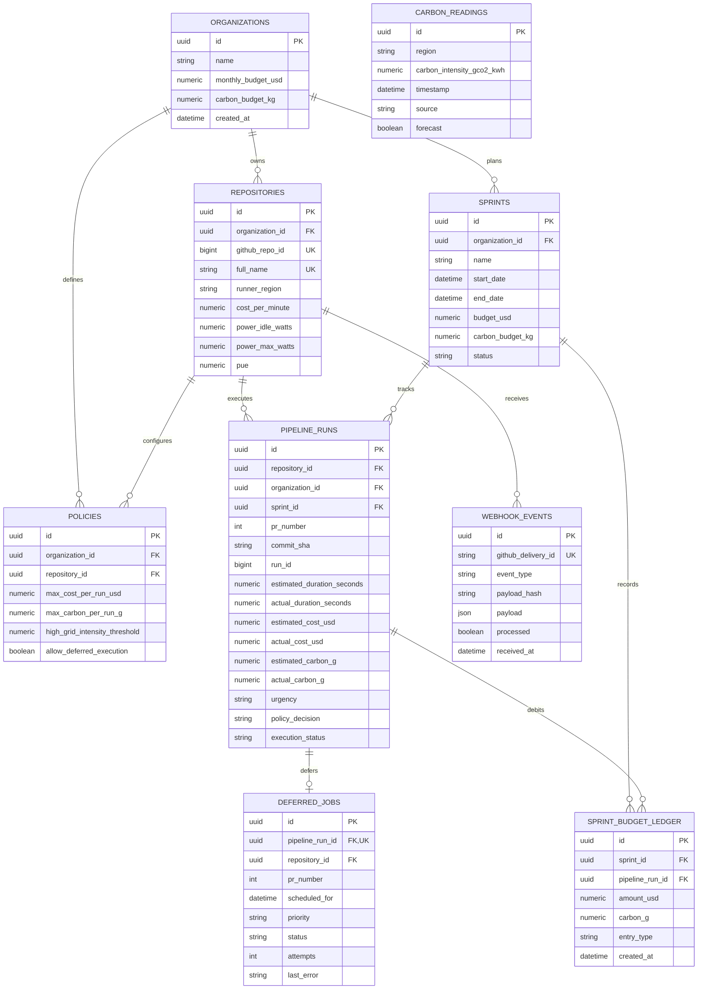

# Database Schema, ER Model & Alembic Migrations

GreenOps uses PostgreSQL for production environments and SQLite for local rapid-testing, managed declaratively via SQLAlchemy 2.0 and version-controlled via Alembic migrations.

---

## 1. Entity Relationship (ER) Model



---

## 2. Table Specifications & Constraints

### `repositories`
- **Primary Key**: `id` (`GUID`)
- **Indexes & Unique Constraints**:
  - `ix_repositories_github_repo_id`: Unique on `github_repo_id`
  - `ix_repositories_full_name`: Unique on `full_name` (`owner/name`)
  - `ix_repositories_organization_id`: Index on `organization_id`
- **Foreign Keys**: `organization_id` $\to$ `organizations.id` (ON DELETE CASCADE)

### `pipeline_runs`
- **Primary Key**: `id` (`GUID`)
- **Indexes**: `commit_sha`, `pr_number`, `repository_id`, `sprint_id`, `organization_id`, `created_at`
- **Foreign Keys**:
  - `repository_id` $\to$ `repositories.id` (ON DELETE CASCADE)
  - `organization_id` $\to$ `organizations.id` (ON DELETE CASCADE)
  - `sprint_id` $\to$ `sprints.id` (ON DELETE SET NULL)

### `deferred_jobs`
- **Primary Key**: `id` (`GUID`)
- **Constraints**:
  - `uq_deferred_jobs_pipeline_run_id`: Unique on `pipeline_run_id` (ensures strict 1-to-1 relationship with pipeline run)
- **Foreign Keys**:
  - `pipeline_run_id` $\to$ `pipeline_runs.id` (ON DELETE CASCADE)
  - `repository_id` $\to$ `repositories.id` (ON DELETE CASCADE)

### `sprint_budget_ledger`
- **Primary Key**: `id` (`GUID`)
- **Indexes**: `sprint_id`, `pipeline_run_id`
- **Foreign Keys**:
  - `sprint_id` $\to$ `sprints.id` (ON DELETE CASCADE)
  - `pipeline_run_id` $\to$ `pipeline_runs.id` (ON DELETE SET NULL)
- **Application Idempotency**:
  - GreenOps enforces idempotency at the service layer in `record_pipeline_ledger_entry()`, querying `(sprint_id, pipeline_run_id, entry_type)` to prevent duplicate debits.

### `webhook_events`
- **Primary Key**: `id` (`GUID`)
- **Constraints**:
  - `ix_webhook_events_github_delivery_id`: Unique on `github_delivery_id` (prevents processing identical webhook deliveries)

---

## 3. Platform-Independent GUID Type

To allow smooth local development with SQLite without breaking PostgreSQL production UUID columns, GreenOps uses a custom SQLAlchemy `TypeDecorator`:

```python
class GUID(TypeDecorator):
    impl = String(36)
    cache_ok = True

    def process_bind_param(self, value, dialect):
        if value is None:
            return value
        elif dialect.name == "postgresql":
            return str(value)
        else:
            return str(uuid.UUID(str(value)))
```

---

## 4. Alembic Migration Architecture

Migrations are versioned in `backend/app/db/migrations/versions/`.

### Migration History
| Revision ID | Description | Down Revision |
|---|---|---|
| `c341c4aec7e3` | Initial comprehensive schema creation with all 8 core entities, indexes, and foreign keys | `None` (Head) |

### Migration Commands
```bash
cd backend

# View current migration head
python -m alembic heads

# View database current revision
python -m alembic current

# Upgrade database to latest revision
python -m alembic upgrade head

# Detect schema/model drift (used in CI)
python -m alembic check
```

---

## 5. Startup Policy: Production vs. Development

In `backend/app/main.py`:
- **Development Mode (`ENVIRONMENT == "development"` and SQLite)**: Automatically calls `Base.metadata.create_all(bind=engine)` if tables do not exist for instant local onboarding.
- **Production Mode (`ENVIRONMENT == "production"` or PostgreSQL)**: `create_all()` is **strictly bypassed**. All schema evolution is governed solely by `alembic upgrade head`.
