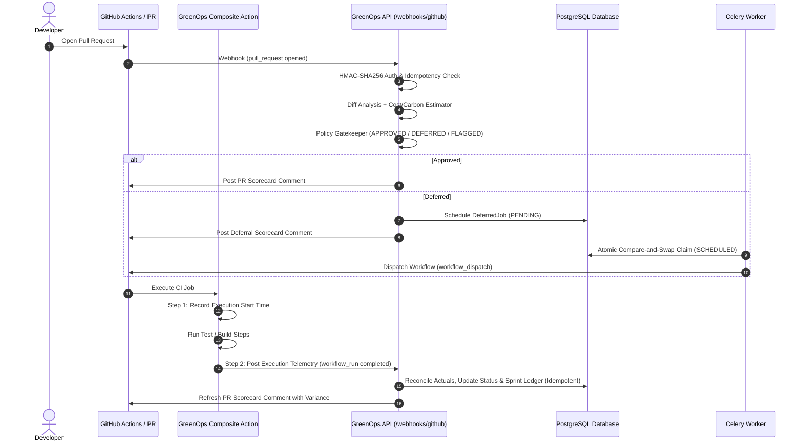

# GitHub Integration & Telemetry Guide

GreenOps integrates with GitHub through a two-way event loop:
1. **Inbound Governance (Pre-Merge)**: Ingests `pull_request` webhooks, estimates compute cost/carbon, and posts dynamic PR scorecards.
2. **Outbound Dispatch (Deferred Execution)**: Dispatches non-critical workflows during lower-carbon grid windows via GitHub's REST API.
3. **Execution Telemetry (Post-Execution)**: Captures authoritative execution metrics (`workflow_run.completed` or composite action) to reconcile estimates against actuals and update the sprint budget ledger.

---

## 1. Architecture Overview



---

## 2. GitHub Composite Action (`github-action/action.yml`)

Repositories can integrate GreenOps telemetry reporting directly into their workflows using the included composite action:

### Usage Example in `.github/workflows/ci.yml`

```yaml
name: CI Pipeline

on:
  pull_request:
    branches: [main]
  push:
    branches: [main]

jobs:
  build-and-test:
    runs-on: ubuntu-latest
    steps:
      - name: Checkout Code
        uses: actions/checkout@v4

      # 1. Initialize GreenOps Gatekeeper & Start Timer
      - name: GreenOps Gatekeeper & Telemetry Initialization
        id: greenops
        uses: ./github-action
        with:
          greenops_endpoint: 'https://greenops-api.onrender.com'
          webhook_secret: ${{ secrets.GREENOPS_WEBHOOK_SECRET }}
          urgency: 'ROUTINE'
          pr_number: ${{ github.event.pull_request.number }}

      # 2. Run your existing CI steps
      - name: Run Tests
        run: |
          npm test

      # Note: Step 2 of the composite action runs automatically with `if: always()`,
      # measuring exact elapsed duration and reporting status, cost, and carbon back to GreenOps.
```

### Action Configuration Inputs

| Input | Description | Required | Default |
|---|---|---|---|
| `greenops_endpoint` | Base URL of the deployed GreenOps backend API. | No | `https://greenops-api.onrender.com` |
| `webhook_secret` | Shared HMAC-SHA256 secret for authenticating telemetry payloads. | No | `""` (Dev mode allows unauthenticated payloads if omitted) |
| `urgency` | PR urgency classification (`HOTFIX`, `BLOCKING`, `ROUTINE`). | No | `ROUTINE` |
| `pr_number` | Associated GitHub pull request number. | No | Auto-discovered from GitHub context |

---

## 3. Webhook Ingestion & Telemetry Processing

### Inbound Endpoints

- **URL**: `POST /api/v1/webhooks/github`
- **Headers**:
  - `X-GitHub-Event`: Event name (`pull_request` or `workflow_run`)
  - `X-GitHub-Delivery`: Unique UUID for delivery idempotency
  - `X-Hub-Signature-256`: `sha256=<hex_hmac>`

### Supported Events & Behaviors

#### `pull_request` (`opened`, `synchronize`, `reopened`)
1. Autoregisters the GitHub repository and organization if not previously known.
2. Retrieves PR file changes via GitHub API or synthetic payload diff.
3. Classifies files (source, test, documentation, CI configuration).
4. Calculates estimated duration, compute cost ($), server energy (kWh), and Scope-2 carbon ($g\text{CO}_2e$).
5. Evaluates the policy gatekeeper against active sprint budget thresholds and regional grid carbon intensity.
6. Generates or updates the markdown scorecard comment on the PR.

#### `workflow_run` (`completed`)
1. Parses authoritative elapsed runtime using `run_started_at` and `updated_at`:
   $$\text{Duration (seconds)} = \text{updated\_at} - \text{run\_started\_at}$$
2. Correlates the execution with the existing repository and pipeline run by `run_id` or `commit_sha`.
3. Computes actual compute cost, server energy, and carbon emissions.
4. Maps terminal status:
   - `conclusion == "success"` $\to$ `COMPLETED`
   - `conclusion == "cancelled"` $\to$ `CANCELLED`
   - `conclusion == "failure"` $\to$ `FAILED`
5. Reconciles any linked `DeferredJob` record.
6. **Sprint Ledger Idempotency**: Records the actual debit in `sprint_budget_ledger`. If an entry for `(sprint_id, pipeline_run_id, 'ACTUAL_DEBIT')` already exists, it updates the record instead of appending duplicate debits.
7. Refreshes the PR comment in-place to display estimated vs. actual variance.

---

## 4. In-Place PR Scorecard Updates

GreenOps identifies PR comments using the hidden HTML comment marker:
```html
<!-- greenops-scorecard -->
```
When subsequent commits are pushed or when actual telemetry completes:
- GreenOps queries the GitHub Comments API for an existing comment containing this anchor.
- If found, it calls `PATCH /repos/{owner}/{repo}/issues/comments/{comment_id}` to update the table in-place.
- If not found, it creates a new comment via `POST`.

This prevents notification spam and keeps PR discussions clean and organized.

---

## 5. Automated Dispatch for Deferred Workflows

When the Policy Gatekeeper returns `DEFERRED`:
1. A `DeferredJob` record is created in PostgreSQL with `status = "PENDING"`.
2. The Celery background beat worker periodically evaluates eligible deferred jobs whose `scheduled_for` timestamp has arrived.
3. The worker acquires an atomic compare-and-swap claim (`status = "SCHEDULED"`).
4. The worker dispatches the workflow via GitHub's REST API:
   ```http
   POST /repos/{owner}/{repo}/actions/workflows/{workflow_file}/dispatches
   Authorization: Bearer <GITHUB_TOKEN>
   Content-Type: application/json

   {
     "ref": "main",
     "inputs": {
       "pr_number": "42",
       "trigger_reason": "GreenOps Deferred Job Dispatch"
     }
   }
   ```
5. Upon successful dispatch (HTTP 204), the job status updates to `DISPATCHED`.
