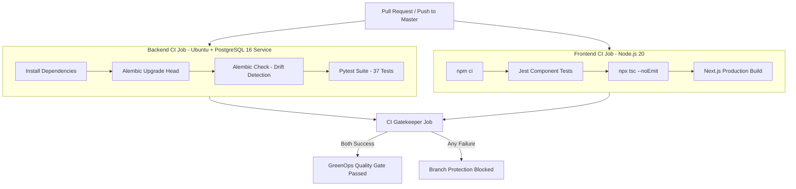

# GreenOps Quality Assurance & Testing Strategy

GreenOps implements an enterprise-grade testing strategy verifying mathematical precision, background worker reliability, webhook authentication, database schema evolution, and user interface responsiveness.

---

## 1. Automated Test Matrix

### A. Backend Quality Gates (Pytest: 37 Tests)

| Layer & Module | Test File | Scope & Assertions |
|---|---|---|
| **Mathematical Modeling Engines** | `backend/tests/unit/test_engines.py` | Compute cost formula (`Decimal` precision), server power model (PUE, $P_{\text{idle}}$, $P_{\text{max}}$, CPU utilization), Scope-2 Carbon ($\text{gCO}_2\text{e}$), zero/negative boundaries, and historical median / deterministic heuristic duration estimators. |
| **PR Diff Analysis & Classification** | `backend/tests/unit/test_diff_analyzer.py` | Multi-language extension categorization (source, unit tests, integration tests, CI pipelines, documentation, infrastructure) and change volume metrics. |
| **Policy Gatekeeper Engine** | `backend/tests/unit/test_policy.py` | Production Hotfix priority bypass, routine run deferral on peak regional carbon intensity, hard sprint budget overrun blocking, and single-run budget caps. |
| **Scheduler & Deferred-Job Reliability** | `backend/tests/unit/test_scheduler_service.py` | Atomic database compare-and-swap claims (`SCHEDULED`), race condition mitigation between concurrent workers, exponential retry limits (max 3 attempts), stale claim recovery (5-minute timeout), and manual REST dispatch synchronization. |
| **Execution Telemetry & Idempotency** | `backend/tests/unit/test_telemetry_webhook.py` | `workflow_run.completed` ingestion, elapsed duration calculation from start/end timestamps, actual cost/carbon calculation, PR comment updating, cancelled workflow mapping (`CANCELLED`), and Sprint Ledger idempotency preventing double-debits across distinct delivery IDs. |
| **Webhook Ingestion Security** | `backend/tests/unit/test_webhooks.py` | Constant-time HMAC-SHA256 signature validation (`X-Hub-Signature-256`), 401 Unauthorized rejection on forged signatures, and delivery ID idempotency skipping. |
| **Database & Migration Safety** | `backend/tests/unit/test_migrations.py` | Single Alembic revision head validation (`c341c4aec7e3`), fresh database upgrade to head, baseline table preservation, and schema/model drift detection. |
| **Health & Data Model Basics** | `backend/tests/unit/test_health_and_models.py` | `/healthz`, `/ready` endpoints, and SQLAlchemy entity instantiation with platform-independent GUID types. |
| **End-to-End Pipeline Integration** | `backend/tests/integration/test_pipeline_flow.py` | Complete lifecycle: PR diff analysis → Estimation → Policy evaluation → Scorecard comment → Workflow completion telemetry → Actuals vs. Estimates variance reconciliation. |

### B. Frontend Quality Gates (Jest & TypeScript: 14 Tests)

| Component / Utility | Test File | Scope & Assertions |
|---|---|---|
| **Budget Gauge** | `frontend/__tests__/components/BudgetGauge.test.tsx` | Visual rendering of consumption percentages, threshold color shifts (green under 80%, yellow at 80-99%, red at 100%+), and over-budget warnings. |
| **Stat Card** | `frontend/__tests__/components/StatCard.test.tsx` | Correct formatting of currency, carbon emissions, percentages, and sub-labels. |
| **Status Badge** | `frontend/__tests__/components/Badge.test.tsx` | Correct semantic styling and labels for `APPROVED`, `DEFERRED`, `FLAGGED`, `COMPLETED`, `RUNNING`, and `FAILED` states. |
| **TypeScript Strict Checking** | `npx tsc --noEmit` | Strict compile-time validation across all TypeScript pages, components, and API client interfaces with 0 errors. |
| **Next.js Production Build** | `npm run build` | Optimization and static pre-rendering verification across all 10 application routes. |

---

## 2. Test Execution Commands

### Running Backend Tests
```bash
cd backend

# Run the complete test suite
python -m pytest -v

# Run with test coverage report
python -m pytest --cov=app --cov-report=term-missing tests/ -v

# Run specific unit test files
python -m pytest tests/unit/test_scheduler_service.py -v
python -m pytest tests/unit/test_telemetry_webhook.py -v
```

### Running Database Migration Verification
```bash
cd backend

# Verify single migration head
python -m alembic heads

# Verify current database status
python -m alembic current

# Verify no un-migrated model changes exist (zero drift)
python -m alembic check
```

### Running Frontend Tests & Builds
```bash
cd frontend

# Run Jest component test suites
npm test

# Run strict TypeScript validation
npx tsc --noEmit

# Run Next.js production build
npm run build
```

---

## 3. Distributed Reliability & Edge Cases Covered

1. **Worker Claim Races**: Verified that when two scheduler workers concurrently attempt to claim the same deferred job, exactly one worker succeeds (`rows_updated == 1`) while the other receives `None`.
2. **Crash Before Dispatch**: Verified that if a worker claims a job but crashes before dispatching, the job remains in `SCHEDULED` and is automatically recovered after `CLAIM_TIMEOUT_MINUTES = 5`.
3. **Dispatch Retries & Terminal Failure**: Verified that transient GitHub dispatch failures transition the job back to `PENDING` for subsequent retry ticks, and transition to `FAILED` after reaching `MAX_DISPATCH_ATTEMPTS = 3`.
4. **Duplicate Telemetry Deliveries**: Verified that if GitHub redelivers a webhook with a different `X-GitHub-Delivery` ID or if custom telemetry reports alongside native webhooks, the sprint ledger is **not double-debited**.
5. **Aborted Workflows**: Verified that `conclusion: "cancelled"` correctly updates the execution status to `CANCELLED` on both the pipeline run and deferred job without leaving hanging records.

---

## 4. Continuous Integration (CI) Workflow

The automated CI pipeline defined in `.github/workflows/ci.yml` runs on every pull request and push to `master`:


